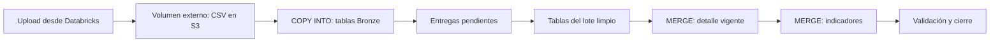

# Laboratorio 07 — SQL Editor, volumen S3 y cargas incrementales

Esta es la ruta principal SQL. La [parte PySpark paso a paso](pyspark/README.md)
incluye el mismo flujo incremental, los mismos temas y un Job de notebooks.
Ambas rutas comparten volumen y tablas workspace.bronze; ejecutarlas de manera
secuencial y mantener una sola ruta de automatización activa.

## Metadata

| Campo | Valor |
| --- | --- |
| Sesión | 07, alcance solicitado por el instructor |
| Módulo | Delta Lake, Medallion, agregaciones y joins |
| Audiencia | Negocio y analistas de datos |
| Herramienta | SQL Editor y Catalog Explorer |
| Lenguaje | SQL directo, con sentencias terminadas en punto y coma |
| Tipo | GUIDED + PRACTICE, sin peso en evaluaciones oficiales |
| Duración | 120 minutos; automatización completa como continuación |
| Nivel | Fundamental, con código preparado y explicado |
| Modalidad | S3: PRACTICO_CONDICIONAL; alternativa administrada: PRACTICO_FREE |
| Requiere S3 | Sí: volumen externo de archivos y tablas Delta externas |
| Requiere GitHub | Solo descarga de los materiales |
| Catálogo y schema | workspace.bronze |
| Fecha de carga | CURRENT_DATE(), calculada por el servidor SQL |
| Dataset | Dos entregas sintéticas: 27 filas y 11 filas |
| Conceptos previos | Filas, columnas, claves, SELECT y WHERE |

## Contexto de negocio

Una aseguradora ficticia recibe novedades de pólizas, productos y siniestros.
Comercial necesita la prima vigente por producto; Operaciones necesita
relacionar esa cartera con sus siniestros. Los datos son sintéticos, en PEN,
y no representan información ni reglas internas de La Positiva.

## Objetivo de aprendizaje

Subir archivos desde Databricks a un volumen con ubicación S3, cargarlos
incrementalmente en Bronze, aplicar altas y cambios a otras tablas y consultar
indicadores. Reutilizar las mismas sentencias en SQL Editor y en un Job SQL.

## Qué aprenderás

El volumen permite subir CSV desde Databricks. COPY INTO carga archivos nuevos
y registra la fecha del servidor. Las entregas pendientes se detectan mediante
tablas; MERGE agrega claves nuevas o aplica versiones más recientes. GROUP BY,
JOIN, funciones de texto/fecha y Window permiten preparar e interpretar reportes.

Los scripts son SQL directo. Abrirlos, copiar su contenido en SQL Editor y
seleccionar las sentencias que se quieran ejecutar. No se configuran parámetros
de fecha. Cada script usa workspace.bronze y consulta tablas persistentes.



## Requisitos previos

El instructor prepara SQL Warehouse y una External Location que autorice el
prefijo S3 de la práctica. Para crear el volumen necesita USE CATALOG,
USE SCHEMA, CREATE VOLUME en el schema y CREATE EXTERNAL VOLUME en la External
Location. Para subir archivos, los participantes necesitan USE CATALOG,
USE SCHEMA y WRITE VOLUME; COPY INTO necesita READ VOLUME y acceso de escritura
a las tablas de destino. El instructor prepara estos permisos antes de clase.

El volumen se crea como workspace.bronze.s07_archivos. Las tablas Delta tienen
sus propias ubicaciones S3, separadas del prefijo del volumen.

## Dataset

Los CSV incluyen id_lote para identificar la entrega de origen. Ese valor ya
viene en el archivo; el participante no lo introduce en SQL Editor. Las etiquetas
2026-10-06 y 2026-10-07 identifican estos ejemplos, no la fecha en que se ejecuta
la práctica. Ambas entregas pueden subirse y procesarse durante la misma clase.

| Concepto | De dónde sale | Qué representa |
| --- | --- | --- |
| id_lote | CSV | Identificador de la entrega de origen |
| fecha_actualizacion | CSV | Momento del cambio en el sistema ficticio |
| fecha_carga | CURRENT_DATE() | Día en que COPY INTO incorpora el archivo |
| fecha_proceso | CURRENT_TIMESTAMP() | Momento del cierre validado de la entrega |

La fecha automática usa la configuración de la sesión SQL. La detección de
pendientes no filtra por “solo hoy”; así una entrega que falló ayer puede
completarse hoy sin cambiar fechas ni volver a cargar el archivo.

Primera entrega:

- [polizas_2026-10-06.csv](data/polizas/polizas_2026-10-06.csv): 13 filas.
- [productos_2026-10-06.csv](data/productos/productos_2026-10-06.csv): 4 filas.
- [siniestros_2026-10-06.csv](data/siniestros/siniestros_2026-10-06.csv): 10 filas.

Segunda entrega:

- [polizas_2026-10-07.csv](data/polizas/polizas_2026-10-07.csv): 5 filas.
- [productos_2026-10-07.csv](data/productos/productos_2026-10-07.csv): 1 fila.
- [siniestros_2026-10-07.csv](data/siniestros/siniestros_2026-10-07.csv): 5 filas.

| Registro | Cambio en la segunda entrega |
| --- | --- |
| POL002 | Prima pasa de 1,500 a 1,600 |
| POL003 | Prima desconocida pasa a 1,100 |
| POL007 | Producto pasa de P02 / Salud a P03 / Hogar |
| POL013 | Nueva póliza de Salud con prima de 1,400; incluye una copia exacta |
| P03 | Nombre pasa a Seguro Hogar Integral Demo |
| SIN003 | Monto desconocido pasa a 200 |
| SIN005 | Referencia cambia de POL006 a POL007; el monto sigue en 400 |
| SIN010 y SIN011 | Dos siniestros nuevos, por 300 y 150; SIN010 tiene una copia |

P99 carece de catálogo; P04 no tiene cartera; SIN009 referencia POL999, ausente.
Estos casos son intencionales. Los dos eventos de POL001 y POL009 son legítimos.

## Escenario

Bronze conserva entregas y versiones. Las tablas de lote conservan una fila
limpia por entrega y clave. El detalle conserva una fila vigente por clave.
Gold conserva una fila por producto con cartera. Los prefijos de tabla expresan
esas funciones dentro del schema workspace.bronze.

| Tablas | Función |
| --- | --- |
| s07_bronze_polizas, s07_bronze_productos, s07_bronze_siniestros | Entregas originales y fecha de carga automática |
| s07_entregas_pendientes | Entregas recibidas que aún no han terminado |
| s07_lote_polizas, s07_lote_productos, s07_lote_siniestros | Cambios limpios por entrega |
| s07_silver_polizas, s07_silver_productos, s07_silver_siniestros | Estado vigente por clave |
| s07_productos_afectados | Productos que deben recalcularse por entrega |
| s07_siniestros_por_poliza | Resumen previo al join con cartera |
| s07_gold_cartera | Indicadores vigentes por producto |
| s07_control_lotes | Entregas validadas y fecha de cierre automática |

Las claves se verifican con consultas. COPY INTO mantiene su propio historial
de archivos; la tabla de control identifica las entregas que ya terminaron.

## Opción A — práctica principal

El volumen tiene esta correspondencia:

```text
workspace.bronze.s07_archivos
/Volumes/workspace/bronze/s07_archivos/
                 ↕
s3://<S3_BUCKET>/landing/sesion-07/
```

Subir archivos a /Volumes/... escribe en el S3 del volumen externo. Las tablas
Delta se almacenan en los prefijos bronze, silver, gold y output de sesión-07.
No registrar tablas Delta dentro del directorio del volumen de archivos.

## Opción B — fallback para Free Edition

Si no se permite crear un volumen externo, el instructor prepara un volumen
administrado con el mismo nombre mediante CREATE VOLUME, sin EXTERNAL ni
LOCATION. También omite LOCATION en el DDL de tablas. La carga desde la interfaz
y los SQL 01–06 mantienen las mismas rutas de volumen y consultas. Este fallback
no acredita almacenamiento en el S3 académico solicitado.

Si Jobs está restringido, ejecutar manualmente 01–05 y demostrar el DAG desde
el entorno del instructor. Si no hay compute, interpretar los resultados.
Revisar las [limitaciones de Free Edition](https://docs.databricks.com/aws/en/getting-started/free-edition-limitations)
antes de clase y cambiar al fallback dentro de los diez minutos iniciales.

## Qué cambia en producción

Acordar cuándo una entrega está completa y verificar su manifiesto. Este
laboratorio requiere las tres entidades con al menos una fila por entrega,
archivos inmutables y un id_lote distinto para cada nueva entrega. Permitir
entidades sin cambios requiere un control de recepción adicional. Una misma
clave y fecha_actualizacion se repite solo con atributos idénticos en el ejemplo.

Una ausencia en el incremental no elimina un contrato. Para bajas se necesita
una señal explícita. Las operaciones de varias tablas no son una sola
transacción; el consumo espera el cierre validado. Usar una ejecución simultánea.

## Actividades

### Paso 1 — Crear el volumen externo y las tablas

1. Abrir SQL → SQL Editor → nueva consulta y seleccionar el SQL Warehouse.
2. Copiar [00-crear-tablas-s3.sql](00-crear-tablas-s3.sql).
3. El instructor reemplaza <S3_BUCKET> por el bucket autorizado y ejecuta 00
   una sola vez. El SQL crea el volumen y las tablas en workspace.bronze.
4. Revisar DESCRIBE VOLUME: tipo externo y ubicación S3 correcta.
5. Revisar DESCRIBE DETAIL de las tablas: Delta y ubicaciones separadas.
6. Guardar la consulta como s07_00_preparacion.

Si ya se utilizó la versión anterior, el instructor revisa si las tablas Bronze
necesitan la columna fecha_carga antes de ejecutar la nueva carga. No borrar datos
ni reemplazar las tablas para incorporar la fecha.

### Paso 2 — Crear las carpetas desde Databricks

1. Abrir Catalog → workspace → bronze → Volumes → s07_archivos.
2. Elegir Create directory y crear polizas, productos y siniestros.
3. Comprobar estas rutas:

```text
/Volumes/workspace/bronze/s07_archivos/polizas/
/Volumes/workspace/bronze/s07_archivos/productos/
/Volumes/workspace/bronze/s07_archivos/siniestros/
```

### Paso 3 — Subir la primera entrega desde Databricks

1. En el menú lateral abrir New → Add or upload data → Upload files to a volume.
2. Seleccionar los archivos de la primera entrega.
3. Cargar pólizas en la carpeta polizas, productos en productos y siniestros en
   siniestros. Seleccionar la carpeta destino del volumen, no una tabla.
4. Conservar los nombres originales y reservar la segunda entrega para el paso 8.
5. Revisar que los tres archivos aparezcan en Catalog Explorer.

Se puede acceder a la misma carga desde Catalog Explorer → Add data → Upload
files to a volume. No se utiliza la consola AWS para subir los CSV.

### Paso 4 — Cargar Bronze y detectar pendientes

1. En una nueva consulta SQL Editor, copiar [01-cargar-bronze.sql](01-cargar-bronze.sql).
2. Ejecutar SELECT CURRENT_DATE() y CURRENT_TIMESTAMP() para ver la fecha/hora.
3. Ejecutar las tres instrucciones COPY INTO. Cada una lee /Volumes/... y
   guarda fecha_carga con CURRENT_DATE().
4. Confirmar 13 pólizas, 4 productos y 10 siniestros originales en Bronze.
5. Ejecutar la detección y controles de entregas pendientes. Debe aparecer
   una entrega disponible; el sistema toma su identificador de los CSV.
6. Repetir 01. Los conteos Bronze permanecen iguales y la fecha no se reescribe.
7. Guardar la consulta como s07_01_cargar_bronze.

No activar force = true ni reemplazar archivos anteriores. La idempotencia
por archivo y la deduplicación por registro resuelven problemas diferentes.

### Paso 5 — Limpiar y aplicar los cambios al detalle

1. Copiar [02-preparar-lote.sql](02-preparar-lote.sql) a otra consulta y ejecutar
   por sentencias: claves repetidas, INSERT del lote limpio y consultas de control.
2. Revisar 12 pólizas, 4 productos y 9 siniestros únicos de la primera entrega.
3. Identificar CAST, UPPER, TRIM y COALESCE. POL003 conserva prima NULL.
4. Copiar [03-actualizar-detalle.sql](03-actualizar-detalle.sql) y ejecutar.
5. Leer ON, WHEN MATCHED y WHEN NOT MATCHED. La versión más reciente actualiza;
   una clave nueva se inserta; una versión antigua no retrocede el estado vigente.
6. Confirmar 12 pólizas y 10,400 PEN de prima conocida en el detalle.

Las consultas seleccionan las entregas de s07_entregas_pendientes. No se ingresa
ninguna fecha. Si hay varias entregas pendientes, ROW_NUMBER elige una versión
por clave antes de MERGE para evitar coincidencias múltiples.

### Paso 6 — Practicar consultas sobre las tablas

Copiar [06-consultas-negocio.sql](06-consultas-negocio.sql) en SQL Editor y
practicar filtros, columnas calculadas, COUNT, SUM, AVG, MIN, MAX, joins,
nulos, fechas, texto y ranking. Ejecutar la consulta Gold del final después de 04.

Tras la primera entrega: INNER conserva 11 filas, LEFT 12, RIGHT 12 y FULL 13.
LEFT mantiene P99; RIGHT mantiene P04. Usar alias para distinguir fechas de
actualización. SIN006 tiene cuatro días entre evento y reporte.

### Paso 7 — Actualizar indicadores y cerrar las entregas

1. Copiar [04-actualizar-indicadores.sql](04-actualizar-indicadores.sql) y ejecutar.
2. El primer MERGE guarda un resumen persistente de siniestros por póliza.
3. El siguiente aplica indicadores de los productos afectados a s07_gold_cartera.
4. Consultar las cuatro filas Gold y contrastar con los resultados esperados.
5. Copiar [05-validar-carga.sql](05-validar-carga.sql) y ejecutar.
6. Confirmar los controles correctos, la entrega en s07_control_lotes con
   fecha_proceso del servidor y la lista de pendientes vacía.

Una póliza con varios siniestros aporta su prima una vez. Cuando cambia de
producto, se recalculan el producto anterior y el nuevo. Si un producto pierde
toda su cartera, se retira solo su indicador.

### Paso 8 — Subir y procesar la segunda entrega

1. Subir los tres CSV nuevos a las mismas carpetas del volumen desde Databricks.
2. Ejecutar las consultas 01 → 02 → 03 → 04 → 05 sin cambiar fechas ni parámetros.
3. Bronze acumula 18 pólizas recibidas; el detalle conserva 13 pólizas vigentes.
4. Revisar POL002, POL003, POL007 y POL013 y explicar los cambios.
5. Confirmar 13,000 PEN de prima total y 2,450 PEN de monto registrado asociado.
6. Repetir 01–05: los valores no cambian y pendientes permanece vacía.

Ambas entregas pueden cargarse el mismo día. Si se suben juntas antes de 01,
la ejecución obtiene directamente el estado de la segunda entrega; el control
registra ambas. Para observar la transición, seguir los pasos de forma separada.

### Paso 9 — Resolver dos consultas de negocio

1. Desde Gold, mostrar producto, cantidad de pólizas y prima total de mayor a menor.
2. Desde detalle, contar pólizas por canal_venta.
3. Explicar por qué cinco filas nuevas del archivo no significan cinco pólizas nuevas.
4. Mostrar una tabla desde otra consulta SQL Editor sin repetir la limpieza.

### Paso 10 — Preparar la automatización

Guardar 01–05 como archivos .sql de Workspace y crear un Job con cinco tareas
SQL / File: cargar Bronze → preparar lote → actualizar detalle → actualizar
indicadores → validar. No se configuran parámetros de fecha. La creación
completa del Job se realiza como continuación con la guía del instructor.

### Distribución de 120 minutos

| Actividad | Minutos | Explicación | Ejecución |
| --- | ---: | ---: | ---: |
| SQL Editor, volumen y primera carga desde UI | 10 | 2 | 8 |
| COPY INTO, fecha automática y pendientes | 15 | 6 | 9 |
| Duplicados, nulos y lote limpio | 15 | 6 | 9 |
| MERGE y detalle vigente | 20 | 8 | 12 |
| Agregaciones, joins, fechas y Window | 20 | 8 | 12 |
| Indicadores y validación | 15 | 6 | 9 |
| Segunda entrega y consultas breves | 15 | 6 | 9 |
| Demostración de automatización | 10 | 6 | 4 |
| **Total** | **120** | **48** | **72** |

## Resultado esperado

| Punto de control | Primera entrega | Segunda entrega |
| --- | ---: | ---: |
| Filas Bronze acumuladas: pólizas | 13 | 18 |
| Filas Bronze acumuladas: productos | 4 | 5 |
| Filas Bronze acumuladas: siniestros | 10 | 15 |
| Pólizas vigentes | 12 | 13 |
| Pólizas activas | 10 | 11 |
| Primas informadas | 11 | 13 |
| Prima total | 10,400 | 13,000 |
| Siniestros vigentes, incluido huérfano | 9 | 11 |
| Siniestros asociados a cartera | 8 | 10 |
| Siniestros asociados sin monto | 1 | 0 |
| Monto registrado asociado | 1,800 | 2,450 |
| Productos con cartera en Gold | 4 | 4 |
| Entregas registradas en control | 1 | 2 |
| Entregas pendientes después de 05 | 0 | 0 |

| Producto | Prima inicial | Prima final | Monto registrado final |
| --- | ---: | ---: | ---: |
| P01 / Auto | 3,700 | 4,900 | 1,000 |
| P02 / Salud | 4,000 | 4,200 | 500 |
| P03 / Hogar | 2,200 | 3,400 | 950 |
| P99 / SIN_CATALOGO | 500 | 500 | 0 |

## Validación

Mostrar DESCRIBE VOLUME con S3, archivos en Catalog Explorer, Bronze con
fecha_carga del servidor, detalle sin claves duplicadas, Gold con los totales
esperados y control con pendientes vacía. Repetir la carga y verificar los
mismos datos. Una entrega incompleta debe detener el flujo y quedar pendiente.

## Aplicación en el trabajo diario

El analista sube archivos desde Databricks, consulta entregas y revisa indicadores
desde SQL Editor. El Job reutiliza los mismos archivos SQL. El historial original
permanece en Bronze y una falla puede recuperarse sin introducir una fecha manual.

## Extensión opcional

Explicar qué sucede si llega una versión antigua o si hay dos entregas distintas
en el mismo día. Diseñar el control para una entidad sin cambios.

## Referencias

- [Crear un volumen externo con LOCATION](https://docs.databricks.com/aws/en/sql/language-manual/sql-ref-syntax-ddl-create-volume).
- [Subir archivos y usar rutas de Volumes](https://docs.databricks.com/aws/en/volumes/volume-files).
- [COPY INTO](https://docs.databricks.com/aws/en/sql/language-manual/delta-copy-into).
- [CURRENT_DATE](https://docs.databricks.com/aws/en/sql/language-manual/functions/current_date).
- [Tareas SQL / File en Jobs](https://docs.databricks.com/aws/en/jobs/tasks/sql).
