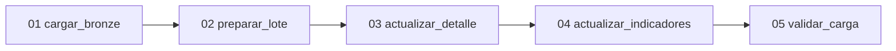

# Automatizar los archivos SQL con un Job

Para la alternativa con notebooks Python, seguir la sección
[Automatización — Job de notebooks PySpark](../../pyspark/README.md#automatización--job-de-notebooks-pyspark).
Ambas rutas usan las mismas tablas y el mismo volumen. Mantener un solo Job
activo sobre ellas y completar cada ejecución antes de iniciar la otra ruta.

## Metadata

- Sesión de origen: 07; continuación de automatización.
- Tipo: GUIDED; duración 30–40 minutos, además de la demostración de cierre.
- Nivel: fundamental; modalidad PRACTICO_CONDICIONAL.
- Requiere S3: volumen externo y tablas; GitHub solo descarga.
- Dataset: las dos entregas del laboratorio.
- Previos: ejecutar manualmente 01–05 en SQL Editor y verificar ambas entregas.

## Contexto de negocio

Los indicadores deben actualizarse después de recibir archivos nuevos en el
volumen. Usaremos los mismos archivos SQL probados desde SQL Editor.

## Objetivo de aprendizaje

Crear un Job con cinco tareas SQL / File, dependencias, horario, reintentos y
revisión de Run History. Las fechas de carga y cierre provienen del servidor.

## Qué aprenderás

Una tarea SQL / File ejecuta un archivo .sql de varias sentencias separadas
por punto y coma. Las tareas comparten resultados mediante tablas persistentes.
El Job detecta entregas pendientes; no recibe un parámetro de fecha.

## Requisitos previos

1. Ejecutar [00-crear-tablas-s3.sql](../../00-crear-tablas-s3.sql) una vez: volumen
   externo workspace.bronze.s07_archivos y tablas workspace.bronze.
2. Probar 01–05 desde SQL Editor. Los CSV se suben mediante Databricks.
3. Guardar 01–05 como archivos .sql de Workspace, conservando su contenido.
4. Preparar un SQL Warehouse compatible con tareas SQL. La identidad Run as
   necesita acceso a los archivos, READ VOLUME, USE CATALOG, USE SCHEMA y
   SELECT/MODIFY sobre las tablas que procesa.

La [documentación de tareas SQL](https://docs.databricks.com/aws/en/jobs/tasks/sql)
admite archivos Workspace con varias sentencias y requiere SQL Warehouse
serverless o pro. Revisar la combinación disponible antes de clase.

## Dataset y escenario

El CSV identifica la entrega mediante id_lote. COPY INTO registra fecha_carga
con CURRENT_DATE() y detecta las entregas que no figuran en control. 02–04
leen s07_entregas_pendientes. 05 valida, registra el cierre y libera pendientes.
Dos entregas distintas pueden procesarse en una sola ejecución el mismo día.

## Actividades

### Paso 1 — Guardar los archivos SQL en Workspace

1. Crear una carpeta de Workspace para los scripts del laboratorio.
2. Subir 01–05 como archivos .sql. Cada archivo contiene SQL directo; no convertirlo
   a un formato de otro editor.
3. Abrir un archivo y revisar que las sentencias son las mismas que se probaron
   desde SQL Editor y terminan en punto y coma.
4. Mantener las rutas /Volumes/workspace/bronze/s07_archivos/... en 01.

Las consultas guardadas de SQL Editor pueden conservarse para el trabajo manual.
El Job utiliza los archivos para ejecutar cada paso completo y en el mismo orden.

### Paso 2 — Crear el Job y la primera tarea

1. Abrir Jobs & Pipelines → Create → Job.
2. Asignar el nombre s07_cartera_incremental_sql.
3. Agregar una tarea de tipo SQL, subtipo File.
4. Seleccionar Source = Workspace y el archivo 01-cargar-bronze.sql.
5. Seleccionar el SQL Warehouse y guardar como cargar_bronze.

### Paso 3 — Crear las cuatro tareas dependientes

Agregar las siguientes tareas SQL / File. Seleccionar el mismo SQL Warehouse,
el archivo correspondiente y la tarea anterior en Depends on. Conservar
Run if = All succeeded.

| Tarea | Archivo | Depends on |
| --- | --- | --- |
| cargar_bronze | 01-cargar-bronze.sql | Ninguna |
| preparar_lote | 02-preparar-lote.sql | cargar_bronze |
| actualizar_detalle | 03-actualizar-detalle.sql | preparar_lote |
| actualizar_indicadores | 04-actualizar-indicadores.sql | actualizar_detalle |
| validar_carga | 05-validar-carga.sql | actualizar_indicadores |

No configurar parámetros de fecha en el Job ni en las tareas. 00 es preparación
única y 06 es exploración; ambos quedan fuera de la ejecución diaria.

### Paso 4 — Ejecutar la primera entrega

1. Subir los tres archivos iniciales desde Databricks al volumen, cada uno en
   su carpeta polizas, productos o siniestros.
2. Elegir Run now, sin parámetros.
3. Revisar que las cinco tareas terminen correctamente.
4. Consultar Gold, control y pendientes desde SQL Editor: 10,400 PEN de prima,
   una entrega cerrada y pendientes vacía.
5. Elegir Run now de nuevo. Los datos conservan los mismos valores.

Si ya se procesaron ambas entregas manualmente, Run now conserva los indicadores
más recientes de 13,000 PEN. Para observar la transición inicial, configurar el
Job antes de subir la segunda entrega. No vaciar tablas para repetir la demostración.

### Paso 5 — Subir la segunda entrega y ejecutar

1. Subir los tres CSV nuevos a las mismas carpetas del volumen desde Databricks.
2. Elegir Run now, sin modificar fechas ni valores de ejecución.
3. Bronze debe acumular 18 pólizas originales; el detalle tiene 13 pólizas vigentes.
4. Confirmar prima total 13,000 PEN y monto registrado asociado 2,450 PEN.
5. Control registra ambas entregas y pendientes queda vacía. Repetir Run now.

### Paso 6 — Concurrencia y recuperación

1. Configurar Max concurrent runs = 1 y un reintento por tarea.
2. Si falla una tarea, revisar su SQL, resultados y error desde la ejecución.
3. Corregir la causa y ejecutar Run now. Cuando esté disponible, usar Repair run.
4. Las entregas permanecen pendientes hasta que 05 termina su validación.

Una falla puede dejar pasos aplicados en tablas distintas. La reejecución
utiliza claves y fechas de actualización para continuar sin duplicar datos.
No se filtran pendientes por la fecha actual: una recuperación al día siguiente
puede completar la entrega anterior. El cierre usa CURRENT_TIMESTAMP().

### Paso 7 — Preparar la programación

1. Definir con el instructor cuándo la entrega está completa en el volumen.
2. En Schedules & triggers, preparar horario diario a las 08:00, America/Lima,
   si la recepción terminó antes de esa hora.
3. Dejar el schedule pausado hasta acordar la recepción diaria.
4. Al activar la programación, el Job carga archivos nuevos y procesa pendientes
   sin parámetros ni fechas escritas por el usuario.

La fecha de carga usa CURRENT_DATE() del motor SQL y la configuración de su sesión.
El calendario de pruebas de los CSV no limita el día en que puede ejecutarse el Job.

### Paso 8 — Probar una entrega incompleta

El instructor puede subir solo el CSV de pólizas de una nueva entrega sintética,
con un id_lote distinto, y ejecutar Run now. 01 detecta que faltan productos o
siniestros; las tareas siguientes no se ejecutan. La entrega queda pendiente y
no aparece como cerrada. Subir los otros archivos y repetir Run now para recuperar.
No reemplazar archivos previos ni activar force = true.

## Resultado esperado

Un Job de cinco tareas SQL / File con dependencias, horario preparado, una
concurrencia y reintentos. Dos entregas pueden procesarse juntas; una ejecución
sin archivos nuevos conserva los indicadores y una entrega incompleta se recupera.

## Validación

Mostrar DAG, Run History, fecha_carga y fecha_proceso del servidor, resultados
Gold, control y pendientes. Confirmar que no se utilizan parámetros de fecha.

## Opción A — práctica principal

Ejecutar el Job sobre el volumen externo y las tablas Delta externas S3.

## Opción B — fallback para Free Edition

Si las tareas SQL están restringidas, ejecutar los archivos 01–05 manualmente
en SQL Editor y demostrar el Job desde el entorno del instructor. Con un
volumen y tablas administradas se conserva la práctica de carga por interfaz,
pero no se acredita almacenamiento en el S3 académico.

## Qué cambia en producción

Utilizar manifiesto de recepción, identidad estable, reglas de bajas y ventanas
de consumo. Permitir cero cambios en una entidad necesita distinguir archivo
vacío de archivo ausente. Las entregas cerradas son inmutables; las correcciones
llegan con un identificador nuevo.

## Aplicación en el trabajo diario

El analista sube los CSV desde Databricks y consulta indicadores en SQL Editor.
El Job ejecuta el mismo SQL y muestra qué paso falló; pendientes permite continuar
una entrega sin volver a ingresar una fecha.

## Extensión opcional

Diseñar el manifiesto mínimo que indique si una entrega está lista para procesarse.
