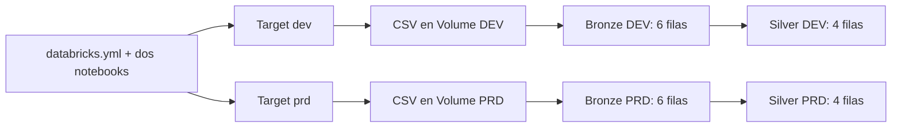

# Laboratorio 13 — Mi primer Bundle: Bronze → Silver

## Metadata

- Módulo: operación y despliegue, según la PPT utilizada por el docente.
- Tema principal nuevo: desplegar el mismo proyecto en dos ambientes mediante YAML.
- Tipo: `GUIDED`; práctica introductoria, sin calificación oficial.
- Duración: 35–40 minutos, con los archivos disponibles antes de empezar.
- Nivel: fundamental.
- Modalidad: `PRACTICO_CONDICIONAL`; fallback manual o `DEMO_INSTRUCTOR`.
- Requiere S3: no. Requiere GitHub: solo para obtener los archivos.
- Dataset: `data/polizas.csv`, seis filas ficticias.
- Conceptos previos: notebooks, tablas Delta, SQL básico, Bronze y Silver, tareas de un Job.

## Contexto de negocio

Una aseguradora ficticia recibe un archivo de pólizas. Un analista necesita
consultarlo con estados uniformes, primas numéricas y sin duplicados exactos
ni primas negativas.

## Objetivo de aprendizaje y qué aprenderás

Desplegar un Job que ejecute dos notebooks en orden y comprobar que el mismo
código escribe en destinos diferentes al elegir `dev` o `prd`.

**Frase para empezar:** «El notebook describe cómo procesar; el YAML describe
qué ejecutar y con qué configuración».

## Escenario: capa y ambiente son dos decisiones diferentes

| Concepto | Pregunta | Ejemplo |
| --- | --- | --- |
| Capa | ¿Qué preparación tienen los datos? | Bronze conserva; Silver limpia. |
| Ambiente | ¿Dónde pruebo o publico? | DEV para probar; PRD para la publicación simulada. |

**Ambos ambientes tienen Bronze y Silver.** En esta práctica PRD también usa
datos ficticios dentro del mismo workspace. Los schemas separan los destinos;
el nombre del ambiente no configura permisos automáticamente.



## Requisitos previos

- Workspace con un catálogo existente; el ejemplo utiliza `workspace`.
- Permiso de uso del catálogo y creación de schemas, volúmenes y tablas.
- Compute serverless para notebooks y Jobs, con cuota disponible.
- Para la opción A: creación o edición de Bundles y despliegue habilitados.
- Para PRD: permiso para crear carpetas y escribir dentro de `/Workspace/producción`;
  si hace falta, el instructor prepara esa carpeta y los permisos de cada participante.
- Elegir un identificador propio, por ejemplo `alumno01`, en minúsculas y sin
  espacios, guiones ni tildes. En un workspace compartido cada persona usa uno diferente.

Los nombres de los controles pueden variar. Esta guía se preparó con materiales
locales, sin verificar la interfaz ni las cuotas de tu workspace. Si no aparece
la opción de Bundles o el target requerido, usa la opción B para continuar.

## Dataset y archivos

```text
laboratorio-13-bundle-bronze-silver/
├── databricks.yml
├── data/polizas.csv
└── src/
    ├── 01-bronze.py
    └── 02-silver.py
```

El CSV contiene un duplicado de `POL001`, una prima negativa en `POL003` y
estados con mayúsculas o espacios distintos. Cada defecto tiene una regla de limpieza.
La muestra sintética puede distribuirse con el curso; `sync.exclude` evita
que se despliegue como parte del Bundle. La cargaremos por separado.

## Opción A — práctica principal

### 1. Preparar los destinos y cargar el archivo — 7 min

En **SQL Editor**, ejecuta lo siguiente. Sustituye `alumno01` por tu identificador
en todas sus apariciones. Si tu catálogo tiene otro nombre, sustituye `workspace`
y luego cambia también `variables.catalog.default` en el YAML.

```sql
CREATE SCHEMA IF NOT EXISTS workspace.s13_alumno01_dev;
CREATE SCHEMA IF NOT EXISTS workspace.s13_alumno01_prd;
CREATE VOLUME IF NOT EXISTS workspace.s13_alumno01_dev.entrada;
CREATE VOLUME IF NOT EXISTS workspace.s13_alumno01_prd.entrada;
```

En **Catalog**, abre cada schema, entra al Volume `entrada` y usa la opción de
cargar archivos para subir el mismo `data/polizas.csv` en ambos destinos:

```text
/Volumes/workspace/s13_alumno01_dev/entrada/polizas.csv
/Volumes/workspace/s13_alumno01_prd/entrada/polizas.csv
```

Son volúmenes administrados. No necesitas configurar AWS ni un External Location.

### 2. Abrir el proyecto como Bundle — 5 min

1. En **Workspace**, usa la opción de crear un **Bundle / Asset bundle**, si está
   disponible. Puedes partir de una plantilla mínima de Job con notebooks.
2. En la raíz del proyecto, reemplaza el contenido de `databricks.yml` por el
   [archivo de este laboratorio](databricks.yml). Este YAML contiene el Job completo;
   no incluye los recursos adicionales que pudiera traer la plantilla.
3. Crea la carpeta `src` e importa allí los dos archivos `.py` como notebooks
   de Databricks, conservando sus nombres. También puedes crear los notebooks y
   copiar las celdas del código suministrado. Comprueba las rutas del YAML.
4. En el YAML cambia `participante.default: alumno01` por tu identificador.
5. Guarda los cambios. Una carpeta con YAML debe reconocerse como proyecto Bundle
   para mostrar sus controles; guardar el archivo por sí solo no despliega nada.

### 3. Explicar solo cinco partes del YAML — 5 min

| Parte | Explicación breve |
| --- | --- |
| `bundle.name` | Nombre del proyecto. |
| `variables` | Catálogo e identificador del participante. |
| `resources.jobs` | Job con las tareas `bronze` y `silver`. |
| `depends_on` | Silver comienza cuando Bronze termina correctamente. |
| `targets` | Configuraciones `dev` y `prd`; `${bundle.target}` se entrega como parámetro `ambiente`. |

Los parámetros del Job llegan a los widgets de ambos notebooks. Con ellos se
construye `s13_<participante>_<ambiente>`. La misma lógica procesa ambos destinos.
`workspace.root_path` separa los archivos y el estado del despliegue. DEV usa la
carpeta personal; PRD sobrescribe esa configuración para desplegar en
`/Workspace/producción/<usuario>/sesion13-polizas`. La subcarpeta de usuario evita
que los participantes compartan el estado de un mismo despliegue.
`mode: production` expresa un modo de despliegue; los schemas los crean
los pasos SQL y las tablas se crean al ejecutar los notebooks.

**Orden de tareas:** `bronze → silver`. Es un Job con notebooks; este ejemplo
no necesita crear un recurso de Declarative Pipeline.

### 4. Desplegar y ejecutar DEV — 7 min

En los controles del Bundle:

1. Selecciona el target **dev**.
2. Valida la configuración, si hay una acción separada de validación.
3. Pulsa **Deploy** o la acción equivalente de despliegue y espera su confirmación.
4. Abre el recurso `polizas_etl` desplegado y ejecuta el Job desde **Run** / **Run now**.
5. En **Jobs & Pipelines → Runs**, comprueba que `bronze` y `silver` terminaron
   correctamente. El modo development puede añadir un prefijo al nombre del Job.

**Deploy crea o actualiza el Job y sus notebooks. Run procesa los datos y crea
las tablas.** Para este ejemplo no configures clúster clásico ni programación horaria.

### 5. Publicar la misma solución en PRD — 5 min

1. Selecciona **prd** en el target del Bundle y despliega.
2. Ejecuta el Job de ese target.
3. En **Workspace → producción → tu usuario → sesion13-polizas**, comprueba los
   archivos desplegados. Los notebooks se encuentran dentro de `files/src`.
4. En Catalog comprueba que aparecen `bronze_polizas` y `silver_polizas` dentro
   de `s13_alumno01_prd`, además de las tablas que ya existen en DEV.

El YAML que define esta ubicación es:

```yaml
targets:
  prd:
    mode: production
    workspace:
      root_path: /Workspace/producción/${workspace.current_user.userName}/${bundle.name}
```

Este fragmento explica la ruta; usa el `databricks.yml` completo para desplegar.
La carpeta contiene código y estado del Bundle. El Job se consulta desde
**Jobs & Pipelines**; las tablas y los archivos CSV siguen en Catalog y Volumes.

Si ya habías desplegado PRD con la ruta anterior, cambiar `root_path` también
cambia la ubicación del estado: puede crear un nuevo Job en vez de actualizar
el anterior. Revisa ambos despliegues antes de retirar el antiguo.

Se despliega el mismo código; cada ejecución lee el archivo del Volume de su
ambiente. No se copian las tablas de DEV a PRD. Si tu interfaz solo permite
desplegar el target de desarrollo, completa PRD con la opción B y registra que
la promoción por Bundle quedó como demostración pendiente.

### 6. Validar y repetir — 6 min

En SQL Editor, ajustando tu identificador:

```sql
SELECT 'dev' AS ambiente,
       (SELECT COUNT(*) FROM workspace.s13_alumno01_dev.bronze_polizas) AS bronze,
       COUNT(*) AS silver, SUM(prima) AS prima_total
FROM workspace.s13_alumno01_dev.silver_polizas
UNION ALL
SELECT 'prd' AS ambiente,
       (SELECT COUNT(*) FROM workspace.s13_alumno01_prd.bronze_polizas) AS bronze,
       COUNT(*) AS silver, SUM(prima) AS prima_total
FROM workspace.s13_alumno01_prd.silver_polizas;
```

| ambiente | bronze | silver | prima_total |
| --- | ---: | ---: | ---: |
| dev | 6 | 4 | 3500.00 |
| prd | 6 | 4 | 3500.00 |

Vuelve a ejecutar el Job de DEV. Los conteos siguen en **6 y 4** porque esta
práctica realiza una carga completa que reemplaza sus propias tablas.
Bronze conserva el contenido de negocio recibido, pero no acumula un histórico
de archivos en este ejemplo.

### Equivalencia opcional con la consola de la PPT

Solo si el instructor ya tiene Databricks CLI y autenticación configuradas:
desde una terminal, en la carpeta que contiene este `databricks.yml`, ejecuta:

```bash
databricks bundle validate -t dev
databricks bundle deploy -t dev
databricks bundle run -t dev polizas_etl

databricks bundle validate -t prd
databricks bundle deploy -t prd
databricks bundle run -t prd polizas_etl
```

Se requiere el perfil del workspace correcto. Estos comandos son una alternativa
a los controles del Bundle. No se ejecutan en SQL Editor ni requieren pegar tokens
en notebooks. Su instalación y autenticación quedan fuera de esta introducción.

## Opción B — fallback para Free Edition

Si faltan controles de Bundles o cuota de Jobs:

1. Prepara los schemas y los archivos como en el paso 1.
2. Importa los dos notebooks en una carpeta de Workspace.
3. Abre `01-bronze`, selecciona compute disponible y configura sus widgets:
   `catalog=workspace`, `participante=tu_identificador`, `ambiente=dev`. Ejecuta todo.
4. En `02-silver`, configura los mismos valores y ejecuta todo.
5. Repite ambos notebooks con `ambiente=prd` y ejecuta la consulta de validación.

Si tampoco puedes crear Volumes, usa **Data Ingestion / Create table from file**
para cargar el CSV directamente como `bronze_polizas` en cada schema. Conserva
las seis filas y configura las tres columnas como `STRING`. Omite `01-bronze`
y ejecuta `02-silver` para cada ambiente. En esta variante Bronze no tendrá
las columnas técnicas `archivo_origen` y `fecha_ingesta`.

Si no puedes crear schemas, el instructor debe preparar los destinos o mostrar
la ejecución. No dediques la sesión a resolver restricciones administrativas.

El fallback permite practicar capas y parámetros. **No acredita un despliegue
con Bundle.** El instructor explica el YAML y muestra `deploy` cuando tenga un
entorno habilitado. Si Jobs está disponible, opcionalmente puede crear un Job
manual con dos tareas y los tres parámetros para representar la dependencia.

## Resultado esperado y validación

| id_poliza | estado_poliza | prima |
| --- | --- | ---: |
| POL001 | ACTIVA | 1200.00 |
| POL002 | VENCIDA | 800.00 |
| POL004 | ACTIVA | 1000.00 |
| POL005 | ACTIVA | 500.00 |

Cada notebook incluye comprobaciones de los resultados. La deduplicación es
por igualdad de las tres columnas de negocio después de normalizarlas; para
la muestra eso deja una fila por póliza.

Entrega una captura de la consulta de conteos, otra del Job con sus dos tareas
correctas si utilizaste Jobs y una frase que explique qué cambia entre DEV y PRD.
Indica si utilizaste Bundle o ejecución manual.

## Data product mínimo que publicamos

| Campo | Definición de la práctica |
| --- | --- |
| Nombre / versión | Pólizas preparadas / v1. |
| Dominio / owner | Pólizas / responsable ficticio de Operaciones. |
| Descripción / consumidores | Pólizas limpias para analistas de operaciones. |
| Activo publicado | `workspace.s13_<participante>_prd.silver_polizas`. |
| Schema | `id_poliza STRING`, `estado_poliza STRING`, `prima DECIMAL(10,2)`. |
| Calidad | Para esta muestra: ID único, estado normalizado y prima no negativa. |
| Freshness / SLO | Actualización bajo demanda; objetivo didáctico: disponible al finalizar correctamente el Job. Sin SLA operativo. |
| Seguridad | Datos sintéticos; el creador consulta la tabla. El acceso de otro analista requiere permisos explícitos. |

El analista puede consultar la tabla publicada desde SQL Editor:

```sql
SELECT *
FROM workspace.s13_alumno01_prd.silver_polizas
ORDER BY id_poliza;
```

## Qué cambia en producción

Los ambientes pueden utilizar workspaces o catálogos diferentes, datos separados,
permisos mínimos y una identidad de servicio para la ejecución. El despliegue
se realiza sobre una versión revisada, con monitoreo y un acuerdo de actualización.
Las cargas, la retención de Bronze y el tratamiento de inválidos se diseñan según
el negocio. Este laboratorio usa dos schemas, un Full Load y la identidad del alumno.

## Aplicación en el trabajo diario

Puedes reutilizar el patrón para recibir un archivo diario de pagos, conservar
una entrada verificable en Bronze y publicar una tabla Silver que los analistas
consulten. El Bundle permite repetir el despliegue del Job cambiando la configuración
del ambiente.

## Extensión opcional

Consulta la prima por estado desde Silver. Si Lineage está habilitado, abre
`silver_polizas` en Catalog y observa su relación con `bronze_polizas`.
