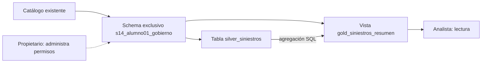

# Laboratorio 14 — Conceder, comprobar y revocar accesos en Unity Catalog

## Metadata

- Módulo: gobierno de datos, seguridad y Unity Catalog; sesión según la PPT del docente.
- Tema: ciclo de vida de acceso y descubrimiento de activos.
- Tipo: `GUIDED` + `PRACTICE`; formativo, sin calificación oficial.
- Duración estimada: **70 minutos**; extensión opcional de Volumes: 15 minutos.
- Nivel: fundamental a intermedio.
- Modalidad: `PRACTICO_CONDICIONAL` para permisos con dos identidades;
  `PRACTICO_FREE` para SQL y exploración sobre objetos propios;
  `DEMO_INSTRUCTOR` / `CONCEPTUAL` cuando falte administración de identidades.
- Requiere S3: no. Requiere GitHub: solo para obtener los archivos.
- Dataset: seis siniestros ficticios incluidos en el SQL; no hay descarga externa.
- Conceptos previos: SQL básico, tabla, vista, Silver/Gold y navegación del workspace.

Materiales: [SQL de preparación](sql/00_preparar_datos.sql),
[SQL del propietario](sql/01_administrar_permisos.sql),
[SQL del analista](sql/02_validar_analista.sql),
[evidencias](EVIDENCIAS.md) y [guía del instructor](INSTRUCTOR.md).

Complemento solicitado: [S14-G01 — Acceso mediante un grupo](GRUPOS.md),
30 minutos para crear un grupo de cuenta y comparar membresía con revocación.
Puede utilizarse como alternativa al bloque de concesión y revocación; si se
realiza completo además del laboratorio, añade esos 30 minutos a la planificación.

## Contexto de negocio

Una aseguradora ficticia quiere compartir indicadores de siniestros con Analítica.
El analista necesita cantidad y monto pagado por estado. No necesita documentos
individuales ni modificar siniestros. Operaciones aprueba el acceso y después
solicita retirarlo temporalmente.

## Objetivo de aprendizaje

Otorgar el acceso mínimo, probarlo desde la identidad del consumidor, revocarlo
y comprobar el resultado. Después, documentar el activo y rastrear su origen.

## Qué aprenderás

| Etapa | Concepto nuevo principal | Resultado verificable |
| --- | --- | --- |
| Preparación | Jerarquía de objetos | Tabla Silver y vista Gold localizadas en Catalog |
| Concesión | Acceso mínimo | Analista consulta Gold y no puede modificar Silver |
| Revocación | Retiro de acceso | La misma consulta deja de estar autorizada |
| Herencia | Procedencia del permiso | Explicas por qué una revocación directa no fue suficiente |
| Descubrimiento | Contexto del activo | Ficha con owner, descripción, clasificación y lineage |

## Requisitos previos

1. Un catálogo Unity Catalog existente. Usamos `workspace` como ejemplo;
   confirma su nombre con `SHOW CATALOGS` y reemplázalo si corresponde.
2. El creador necesita `USE CATALOG` y `CREATE SCHEMA` sobre el catálogo;
   si el instructor prepara el schema, necesita conceder los permisos para
   crear tabla y vista, o ejecutar él la preparación.
3. Para la ruta real: **dos identidades diferentes del mismo entorno**:
   propietario e integrante de un grupo de cuenta del laboratorio. También
   sirve un usuario existente como destinatario directo. El analista debe
   poder usar SQL Editor y su SQL Warehouse, sin ser propietario ni administrador.
4. La persona que concede permisos debe poder administrarlos en cada objeto.
   El permiso sobre un schema no autoriza por sí solo a conceder `USE CATALOG`.
5. Un identificador por pareja, por ejemplo `alumno01`. Utiliza minúsculas,
   números y guion bajo, sin espacios ni tildes.

Free Edition tiene restricciones administrativas, incluida la ausencia de
Account Console. **No se exige crear grupos o invitar otro usuario desde Free
Edition**. Si no hay dos identidades preparadas, usa la opción B desde el inicio.
Consulta las [limitaciones oficiales de Free Edition](https://docs.databricks.com/aws/en/getting-started/free-edition-limitations).

## Dataset

El [SQL de preparación](sql/00_preparar_datos.sql) crea seis filas limpias,
con identificadores `DOC-DEMO`, estados `ABIERTO` / `CERRADO` y montos en PEN.
No se introducen defectos de calidad: aquí el objetivo es gobierno.

| Activo | Contenido | Uso |
| --- | --- | --- |
| `silver_siniestros` | Seis siniestros y documento ficticio | Detalle restringido de la práctica |
| `gold_siniestros_resumen` | Dos filas agregadas por estado, sin documentos | Consumo del analista |

## Escenario



La vista agrega datos; no implementa una máscara de columna ni una política
ABAC. El documento se excluye de la salida por diseño.

## Actividades

### Preparar archivos y roles — 5 min

1. Descarga la carpeta del laboratorio. Abre los `.sql` en SQL Editor o
   impórtalos como notebooks SQL desde Workspace.
2. Sustituye `workspace` y `alumno01` en **todos** los archivos.
3. En `01_administrar_permisos.sql`, sustituye `s14_alumno01_analistas`
   por el grupo de cuenta preparado o por el usuario existente, conservando
   los backticks. El nombre mostrado es un ejemplo, no un grupo ya creado.
4. Asigna los roles y abre [EVIDENCIAS.md](EVIDENCIAS.md).

| Perfil de negocio ficticio | Necesidad | Diseño de mínimo privilegio |
| --- | --- | --- |
| Analista | Consultar indicadores | Uso de padres y `SELECT` solo en Gold |
| Ingeniero | Mantener Silver existente | Uso de padres, `SELECT` y `MODIFY` en Silver; creación solo si su tarea lo requiere |
| Auditor | Revisar un activo autorizado | Lectura del activo acordado; acceso a metadata según alcance |

En esta práctica ejecutamos los cambios **solo para el analista**. Los otros
perfiles son decisiones de diseño. El instructor actúa como propietario técnico.

## Opción A — práctica principal

### 1. Crear y reconocer los activos — 10 min

**Propietario:** ejecuta [00_preparar_datos.sql](sql/00_preparar_datos.sql)
una sola vez, hasta las validaciones. Los tags quedan como actividad opcional.
Si el schema ya existe, cambia el identificador; si una ejecución quedó a medias,
continúa desde la celda pendiente sin repetir el `INSERT`.

En SQL Editor, ejecuta cada sentencia **completa hasta su punto y coma**, aunque
ocupe varias líneas. En `COMMENT ON ... IS 'texto';`, el texto entre comillas
forma parte del comando: ejecutar solo hasta `IS` produce un error de sintaxis.
La sintaxis para comentar tablas y vistas es `COMMENT ON TABLE`, según la
[referencia de COMMENT ON](https://docs.databricks.com/aws/en/sql/language-manual/sql-ref-syntax-ddl-comment).

En **Catalog**:

1. Abre tu catálogo y el schema `s14_<identificador>_gobierno`.
2. Localiza la tabla Silver y la vista Gold.
3. En **Overview**, revisa descripción, columnas y owner.
4. En **Permissions**, identifica los permisos existentes. Registra la línea
   base con la etapa **A** de `01_administrar_permisos.sql`.

**Analista:** abre [02_validar_analista.sql](sql/02_validar_analista.sql)
en su propia sesión, ejecuta `current_user()` y prueba cada consulta por
separado. Antes de conceder, tabla y vista deberían quedar sin acceso.

Si ya puedes leerlas, revisa permisos y grupos con el instructor. No continúes
afirmando que el acceso está restringido. No retires permisos de grupos generales
del workspace para acomodar el laboratorio; usa otro entorno aislado o la opción B.

### 2. Conceder lectura usando la interfaz y reconocer su SQL — 15 min

**Propietario**, desde Catalog Explorer:

1. En el catálogo → **Permissions**, verifica que el principal tenga
   `USE CATALOG`. Si falta y estás autorizado, pulsa **Grant**, selecciona
   el principal y concede solo ese privilegio.
2. En el schema del laboratorio → **Permissions → Grant**, concede `USE SCHEMA`.
3. Abre la **vista Gold** → **Permissions → Grant** y concede `SELECT`.
4. Revisa los tres niveles. No concedas `SELECT` sobre el catálogo ni sobre
   todo el schema en esta etapa.

La etapa **B1–B2** de [01_administrar_permisos.sql](sql/01_administrar_permisos.sql)
es el equivalente SQL. Puedes usar interfaz o SQL y comparar el resultado;
no hace falta repetir ambos procedimientos.

**Analista:** vuelve a ejecutar las tres pruebas por separado:

- Vista Gold: dos filas.
- Tabla Silver: sin acceso al detalle.
- `UPDATE` sobre Silver: sin autorización de modificación.

Ejecuta las lecturas desde un **SQL Warehouse**. En este escenario la vista
delega el acceso a los datos subyacentes según los permisos de su propietario,
que debe conservarlos. No agregues `SELECT` sobre Silver para resolver un error
de la vista sin investigar primero. Consulta los
[requisitos para consultar vistas](https://docs.databricks.com/aws/en/views/#requirements-for-querying-views).

**Idea para explicar:** `USE CATALOG` y `USE SCHEMA` permiten usar la jerarquía;
`SELECT` permite consultar el objeto. Ver el nombre de un activo no prueba que
puedas leer sus datos. Los tipos de privilegio se describen en la
[referencia de Unity Catalog](https://docs.databricks.com/aws/en/data-governance/unity-catalog/access-control/privileges-reference).

### 3. Revocar y comprobar la pérdida de acceso — 10 min

**Propietario**, sobre la vista Gold:

1. En **Permissions**, selecciona el `SELECT` directo del principal del laboratorio.
2. Pulsa **Revoke** y confirma el cambio.
3. Revisa otra vez los permisos. Conserva los de uso de los padres para aislar
   el efecto de retirar la lectura.

La etapa **C** del SQL realiza lo mismo:

```sql
REVOKE SELECT ON VIEW workspace.s14_alumno01_gobierno.gold_siniestros_resumen
FROM `s14_alumno01_analistas`;
```

**Analista:** ejecuta de nuevo la consulta Gold. Registra el error exacto y tu
identidad. Un error de compute, cuota o sintaxis no demuestra revocación.

Otorgar y revocar desde Catalog y SQL son alternativas documentadas en
[administrar privilegios](https://docs.databricks.com/aws/en/data-governance/unity-catalog/manage-privileges).

### 4. Investigar el acceso heredado — 10 min

Sigue las etapas **D → E → F → G** del SQL del propietario, deteniéndote después
de cada una para que el analista repita las consultas:

| Fase | Cambio del propietario | Vista | Tabla | Modificación |
| --- | --- | --- | --- | --- |
| D | `SELECT` en schema y también directo en tabla | Sí | Sí | No |
| E | Retira el `SELECT` directo de tabla | Sí | **Sí, por herencia** | No |
| F | Retira el `SELECT` del schema | No | No | No |
| G | Concede otra vez `SELECT` solo en Gold | Sí | No | No |

La concesión amplia de D es temporal y se limita al schema aislado de datos
ficticios. En **Permissions**, busca la procedencia del permiso heredado;
revisa el padre donde se concedió. Se retira en ese padre, como muestra F.

**Resultado:** `REVOKE` quita una concesión en un alcance. Para conocer el
acceso efectivo también hay que revisar grupos, padres y ownership. Consulta
el [modelo de permisos y herencia](https://docs.databricks.com/aws/en/data-governance/unity-catalog/access-control/permissions-concepts).

### 5. Descubrir, documentar y seguir el dato — 15 min

Trabaja como **propietario**; no amplíes el acceso del analista para observar
el detalle del lineage.

1. Busca `gold_siniestros_resumen` en Catalog y revisa el comentario de negocio.
   Identifica indicador, fuente, moneda, consumidor y actualización.
2. Localiza el **owner técnico**. Compáralo con el **Data Owner de negocio**
   ficticio del comentario. Completa la ficha: Operaciones aprueba el uso
   (Owner), un responsable de calidad/documentación actúa como Steward y
   el equipo de plataforma administra controles como Custodian.
3. En Silver → **Overview → Tags**, si está habilitado, agrega
   `s14_dominio=siniestros` y `s14_clasificacion=restringido_demo`.
   Puedes utilizar las sentencias comentadas del setup. En la columna
   `numero_documento`, propone o aplica `s14_sensible=documento_demo`.
   Si faltan permisos o la clave es gobernada, registra los valores propuestos
   en la ficha. Un tag gobernado puede necesitar `ASSIGN` adicional.
4. Confirma que el tag es clasificación. Para filtrar filas o enmascarar
   columnas hacen falta controles específicos; el tag por sí solo no los aplica.
   Consulta [aplicación de tags](https://docs.databricks.com/aws/en/database-objects/tags).
5. Ejecuta otra consulta sobre Gold y abre **Lineage**, luego **See Lineage Graph**
   si aparece. Identifica Silver como origen y Gold como salida. Explora
   `monto_pagado → monto_pagado_total` cuando el grafo de columnas lo permita.
6. Si el lineage no aparece, actualiza y revisa permisos y rango temporal;
   continúa con el diagrama del escenario si sigue sin estar disponible.
   Marca la evidencia como **diagramada**. Consulta
   [lineage en Unity Catalog](https://docs.databricks.com/aws/en/data-governance/unity-catalog/data-lineage).

Decide qué revisarías si cambia el tipo de `monto_pagado`. La respuesta debe
señalar la vista y los consumidores que dependan del indicador. Este laboratorio
no crea un dashboard; solo se registran consumidores realmente observados.

## Opción B — fallback para Free Edition

Si no dispones de una segunda identidad o de administración de permisos:

1. Ejecuta el setup con tu usuario sobre objetos propios. Si no puedes crear
   schemas, utiliza uno preparado por el instructor. Si tampoco puedes crear
   objetos, sigue la demo y completa la ficha.
2. Consulta tabla y vista y verifica los conteos. Tu capacidad de leerlas como
   propietario es esperable; **no demuestra** aislamiento del consumidor.
3. Revisa **Overview**, **Permissions** y `SHOW GRANTS` de los objetos propios.
4. Lee las etapas A–G sin ejecutar `GRANT` hacia nombres que no existen ni
   revocar permisos a tu propio usuario para intentar perder acceso.
5. Antes de consultar los resultados esperados, predice en la ficha qué podría
   leer y modificar un analista sin ownership ni otras vías de acceso.
6. Compara con la tabla de validación y explica el resultado de E. Si el
   instructor tiene dos identidades habilitadas, observa su demostración de B–C.
7. Completa comments, tags disponibles, responsabilidades y lineage observado
   o diagramado. Guarda dos capturas de exploración y la matriz razonada.

Esta ruta practica navegación y razonamiento de permisos. La revocación real
entre identidades queda como **simulación o demostración**, según lo realizado.
Una cuenta personal de otro participante en otro workspace no sirve para probar
los permisos de tus objetos.

## Resultado esperado

| estado_siniestro | cantidad_siniestros | monto_pagado_total |
| --- | ---: | ---: |
| ABIERTO | 3 | 300.00 |
| CERRADO | 3 | 2700.00 |

Estado final G: el analista tiene lectura del resumen, conserva uso de los
padres y no tiene lectura del detalle ni escritura. El creador mantiene su
ownership para administrar los activos del laboratorio.

## Validación y cierre — 5 min

| Fase | Vista Gold | Tabla Silver | UPDATE Silver |
| --- | --- | --- | --- |
| A | Sin acceso | Sin acceso | Sin acceso |
| B | 2 filas | Sin acceso | Sin acceso |
| C | Sin acceso | Sin acceso | Sin acceso |
| D | 2 filas | 6 filas | Sin acceso |
| E | 2 filas | 6 filas | Sin acceso |
| F | Sin acceso | Sin acceso | Sin acceso |
| G | 2 filas | Sin acceso | Sin acceso |

Esta matriz supone un analista sin otros permisos efectivos. Para cada
revocación usa una **nueva ejecución**, no resultados anteriores. Conserva el
mensaje exacto: un objeto oculto por permisos puede producir un mensaje
diferente de una denegación explícita; el propietario debe confirmar que existe.

Entrega [EVIDENCIAS.md](EVIDENCIAS.md) con las pruebas B, C, E y G, una ficha
de gobierno y una captura o diagrama de lineage. Indica qué fue real, demo o
simulado. El instructor usa [INSTRUCTOR.md](INSTRUCTOR.md) para revisar el resultado.

## Extensión opcional — Volumes DEV/PRD y relación con S3 — 15 min

**Modalidad:** `PRACTICO_CONDICIONAL`; si falta creación de Volumes o segunda
identidad, dibuja rutas y predice los resultados como `CONCEPTUAL`.

**Propietario:** usa nombres nuevos y crea dos volúmenes administrados:

```sql
CREATE SCHEMA workspace.s14_alumno01_dev;
CREATE SCHEMA workspace.s14_alumno01_prd;
CREATE VOLUME workspace.s14_alumno01_dev.entrada;
CREATE VOLUME workspace.s14_alumno01_prd.entrada;
```

En **Catalog → schema → volume → Upload**, carga un pequeño `nota_demo.txt`
con el texto `Datos sinteticos de entrenamiento` en cada volumen. Como
propietario, confirma que puedes listar ambas rutas.

Concede al principal del analista únicamente acceso de lectura a DEV. Ya debe
tener `USE CATALOG` de la actividad principal:

```sql
GRANT USE SCHEMA ON SCHEMA workspace.s14_alumno01_dev
TO `s14_alumno01_analistas`;
GRANT READ VOLUME ON VOLUME workspace.s14_alumno01_dev.entrada
TO `s14_alumno01_analistas`;
SHOW GRANTS ON VOLUME workspace.s14_alumno01_dev.entrada;
```

**Analista:** ejecuta las sentencias de listado por separado:

```sql
LIST '/Volumes/workspace/s14_alumno01_dev/entrada/';
-- DEV: debe listar nota_demo.txt.
LIST '/Volumes/workspace/s14_alumno01_prd/entrada/';
-- PRD: debe fallar por falta de acceso.
```

**Propietario:** retira la lectura DEV y pide repetir su listado:

```sql
REVOKE READ VOLUME ON VOLUME workspace.s14_alumno01_dev.entrada
FROM `s14_alumno01_analistas`;
```

El listado DEV también debe quedar sin acceso. `SELECT` sobre una tabla y
`READ VOLUME` sobre archivos son privilegios distintos. Para escribir archivos
se necesitan lectura y escritura del volumen, además del uso de los padres;
no se concede escritura al analista. Consulta
[privilegios de Volumes](https://docs.databricks.com/aws/en/volumes/privileges).

Completa la cadena conceptual de la PPT:

```text
Bucket S3 + rol IAM
  → Storage Credential (referencia a identidad de acceso)
  → External Location (ruta autorizada y credencial)
  → External Volume o External Table
  → permisos al consumidor sobre el objeto
```

No se configura S3 en esta práctica. Un Volume administrado sigue usando
almacenamiento cloud, pero no requiere conectar tu propio bucket. En un entorno
corporativo, un administrador prepara la integración y restringe también los
accesos directos mediante IAM. No se entregan claves AWS al analista.

## Qué cambia en producción

Los grupos e identidades se administran centralmente. Las aprobaciones,
caducidades y revisiones se documentan; los permisos no expiran por escribir
una fecha en un comentario. Una identidad de servicio puede ejecutar Jobs con
acceso mínimo. El gobierno incorpora auditoría y políticas según el entorno.

| Necesidad | Funcionalidad de Databricks | Tratamiento en esta práctica |
| --- | --- | --- |
| Consultar y retirar lectura | Privilegios Unity Catalog | Ejecución A–G o fallback |
| Descubrir y entender datos | Catalog Explorer, comments, tags, owner | Navegación y ficha |
| Analizar impacto | Lineage | Grafo observado o diagramado |
| Ver solo ciertas filas | Row filters o vistas dinámicas | Overview; requiere diseño y validación propios |
| Ocultar valores de una columna | Column masks | Overview; la agregación de Gold no es una máscara |
| Centralizar reglas por atributos | ABAC y governed tags | Overview condicionado al entorno |
| Compartir notebook, Job o dashboard | Permisos del objeto de Workspace | Revisión conceptual separada de los permisos de datos |
| Investigar quién realizó acciones | Auditoría, por ejemplo `system.access.audit` donde esté habilitada | Demo o análisis conceptual; no es requisito de entrega |

Compartir un notebook no concede por sí solo acceso a tablas. En Jobs y
dashboards también hay que revisar la identidad de ejecución y el modo de
compartir resultados. Lineage describe dependencias; la auditoría registra
acciones. Los mecanismos de acceso se explican en
[control de acceso en Unity Catalog](https://docs.databricks.com/aws/en/data-governance/unity-catalog/access-control).

## Aplicación en el trabajo diario

Puedes publicar una vista de indicadores diarios de pagos y concederla al
equipo que la necesita, manteniendo el detalle reservado. Ante un cambio de
función, revisa permisos directos y de grupos, retira el acceso que ya no se
requiere y prueba de nuevo con la identidad del consumidor. Usa metadata y
lineage para encontrar al responsable y anticipar el impacto de cambios.

Documentación oficial consultada el **4 de noviembre de 2026**. Las rutas de
interfaz y capacidades deben comprobarse en el workspace antes de la sesión.
