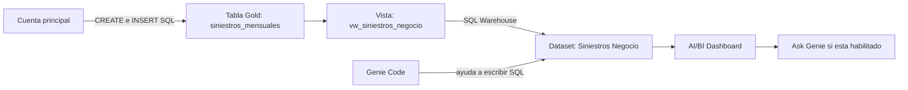

# Laboratorio 15 — De Gold al dashboard de siniestros

## Metadata

- Módulo: Databricks SQL y consumo analítico; continuidad de gobierno de sesión 14.
- Tema: Gold, vista, consultas asistidas y AI/BI Dashboards.
- Tipo: `GUIDED` + `PRACTICE`; actividad formativa, sin peso adicional.
- Duración estimada: 75 minutos de práctica, dentro de una sesión de 120 minutos.
- Nivel: fundamental.
- Modalidad: SQL y vista `PRACTICO_FREE`; Genie, dashboard y segunda identidad `PRACTICO_CONDICIONAL`.
- Requiere S3: no. Requiere GitHub: solo para descargar materiales.
- Dataset: 72 filas agregadas de siniestros ficticios; enero–diciembre de 2025.
- Conceptos previos: `SELECT`, `SUM`, `GROUP BY`, tabla Delta, vista y mínimo privilegio.

## Contexto de negocio

Operaciones de `aseguradora_demo` necesita revisar cuántos siniestros se
reportaron en un año, cuántos están cerrados y sus montos por tipo de seguro.
El analista requiere un dashboard que pueda filtrar sin modificar la tabla.
Todos los datos y reglas son sintéticos; no representan la operación real de
La Positiva ni incluyen información personal.

## Objetivo de aprendizaje

Crear una tabla Gold con SQL `INSERT`, exponer una vista de negocio y utilizarla
para generar SQL con Genie y comenzar un dashboard en Databricks Free Edition.

## Qué aprenderás

| Etapa | Concepto principal | Resultado verificable |
| --- | --- | --- |
| Preparación | Tabla Gold para consumo | Un año completo cargado con `INSERT ... VALUES` |
| Publicación | Vista como punto de consulta | 72 filas accesibles desde SQL |
| Consulta asistida | Validación del SQL de Genie | Una respuesta que coincide con el control |
| Consumo | Dataset y widgets | Indicadores y gráficos que responden al filtro |

## Requisitos previos

1. Cuenta principal: usuario propietario que prepara los objetos en el workspace;
   no significa entrar a Account Console.
2. Un catálogo Unity Catalog existente; el ejemplo usa `workspace`. Confirma con
   `SHOW CATALOGS`. Si tiene otro nombre, reemplázalo en todos los SQL y prompts.
3. La cuenta principal necesita `USE CATALOG` y `CREATE SCHEMA` sobre ese catálogo.
   Si falta el permiso, el instructor prepara el schema y los objetos.
4. SQL Editor y acceso al SQL Warehouse disponible. Utiliza el existente y
   selecciona el mismo para el dashboard; no necesitas un clúster clásico.
5. Para practicar propietario/analista: dos identidades ya habilitadas en el
   **mismo workspace**, con acceso a Databricks SQL y CAN USE del warehouse.
   Puede reutilizarse el grupo existente del laboratorio 14. No se exige crear
   usuarios, grupos ni entrar a Account Console en Free Edition.

**Si cada estudiante tiene un Free Edition independiente**, cada uno prepara
los objetos en su cuenta y actúa como propietario. No podrá consultar la tabla
de la cuenta principal solo por conocer su nombre. No se configura conexión
entre workspaces en esta práctica.

## Dataset

Se suministra Gold ya resumida para concentrarse en consumo. No se ejecuta
otra vez Bronze/Silver ni se convierten las seis filas de la sesión 14 en un año
de historia. Se continúa su patrón de vista gobernada con un dataset nuevo.

| Campo | Significado |
| --- | --- |
| `mes_reporte` | Primer día del mes de reporte, de enero a diciembre de 2025 |
| `tipo_seguro` | AUTO, SALUD o HOGAR |
| `estado_siniestro` | ABIERTO o CERRADO al corte del 31/12/2025 |
| `cantidad_siniestros` | Número de siniestros del grupo |
| `monto_pagado` | Pago acumulado del grupo al corte, en PEN |
| `monto_reservado` | Saldo estimado pendiente ficticio al corte, en PEN |
| `cantidad_cerrados` | Columna de la vista: cantidad del grupo si está CERRADO; 0 si está ABIERTO |
| `fecha_corte` | Columna de la vista: 31/12/2025 |

Una fila representa **mes de reporte + tipo de seguro + estado al corte**.
Son 12 meses × 3 tipos × 2 estados = 72 filas, que representan 2328 siniestros.
Cada siniestro pertenece a un solo grupo: no son snapshots mensuales repetidos.
No hay defectos de calidad intencionales.

**Contar siniestros:** `SUM(cantidad_siniestros)`. `COUNT(*)` cuenta las 72
filas agregadas. Los montos por mes se agrupan por mes de reporte, no por fecha
del pago. El porcentaje de cierre es cerrados/total al corte de la cohorte
seleccionada, no una medida de velocidad de atención. No se usa `CURRENT_DATE()`:
el año histórico y el corte son fijos para poder reproducir los resultados.

## Escenario

El schema `workspace.gold_s15_seguros` contiene tabla y vista. Es un espacio
aislado para esta práctica; no hay que recrear ni modificar el schema de sesión 14.

## Actividades

### Opción A — práctica principal

#### 1. Crear y poblar Gold desde la cuenta principal — 15 min

Abre [00-preparar-gold.sql](sql/00-preparar-gold.sql) en SQL Editor o impórtalo
como notebook SQL. Ejecuta por bloques, seleccionando cada sentencia completa
hasta `;`. Detente si una sentencia falla.

1. Confirma identidad y catálogo.
2. Crea `workspace.gold_s15_seguros` y la tabla `siniestros_mensuales`.
3. Ejecuta el `INSERT OVERWRITE ... VALUES` con las 72 filas literales. No hace
   falta generar datos con Python ni cargar archivos.
4. Valida 72 filas, 12 meses y 2328 siniestros. Localiza el objeto en **Catalog**.

`INSERT OVERWRITE` sustituye las filas de esta tabla didáctica. Permite repetir
**solo la celda de carga** sin duplicar los indicadores. `INSERT INTO` agregaría
otras 72 filas al repetirla. No cambies el destino por una tabla ajena.
La distinción está en la [referencia de INSERT](https://docs.databricks.com/aws/en/sql/language-manual/sql-ref-syntax-dml-insert-into).

Si el schema ya existe, revisa si corresponde a esta preparación. Si ya está
completa, continúa desde las validaciones; no repitas los `CREATE`. Para otra
práctica, elige otro sufijo y reemplázalo en todos los archivos.

#### 2. Crear la vista y preparar el acceso — 5 min

Cuenta principal: ejecuta [01-crear-vista.sql](sql/01-crear-vista.sql).
La vista `vw_siniestros_negocio` añade la cantidad de cerrados y la fecha de
corte. Comprueba sus 72 filas y su descripción en Catalog.

Con dos identidades preparadas, sigue
[03-permisos-opcionales.sql](sql/03-permisos-opcionales.sql) por etapas. Reutiliza
el principal real de sesión 14: lectura solo de la nueva vista, uso de catálogo
y schema, y CAN USE del warehouse. El owner conserva acceso a la tabla.
Valida desde el analista; no retires los permisos del cierre anterior.

Al consultar la vista con SQL Warehouse, el consumidor puede leerla sin
`SELECT` directo en su tabla, siempre que el propietario conserve acceso a la
fuente y se cumplan los requisitos del entorno:
[requisitos para consultar vistas](https://docs.databricks.com/aws/en/views/#requirements-for-querying-views).

#### 3. Generar una consulta con Genie y contrastarla — 15 min

Sigue [GENIE.md](GENIE.md), apartado **Genie Code en SQL Editor**. Genera la
cantidad de siniestros por mes. Revisa el SQL antes de ejecutarlo y compáralo
con la consulta 3 de [02-consultas-y-validacion.sql](sql/02-consultas-y-validacion.sql).

#### 4. Conectar la vista y empezar el dashboard — 30 min

Sigue [DASHBOARD.md](DASHBOARD.md). Crea un dataset desde la vista con la
consulta 1 del SQL. Añade tres indicadores, una línea, barras y filtros.
Compara totales y prueba enero/AUTO. Si sobra tiempo, añade el porcentaje de
cierre y la tabla por estado.

#### 5. Publicar y preguntar con Ask Genie — 10 min

Sigue el cierre de [DASHBOARD.md](DASHBOARD.md) y el segundo apartado de
[GENIE.md](GENIE.md). Publica para tu propia consulta; compartir con otro usuario
es condicional a las identidades disponibles. No se requiere Power BI.

### Opción B — fallback para Free Edition

- **Sin segunda identidad:** ejecuta con tu usuario y documenta que eres owner;
  no presentes la lectura propia como prueba de aislamiento.
- **Sin Genie:** usa los prompts y las consultas de referencia de `02`. Explica
  qué validarías y marca la actividad asistida como simulada.
- **Sin AI/BI Dashboards:** ejecuta `02` desde un notebook SQL con serverless.
  En la salida de las consultas 3 y 4, usa **Visualization / +** para crear una
  línea y barras si está disponible. Usa la consulta 6 para simular el filtro.
  Si tampoco hay visualización, entrega tablas SQL y el diseño del dashboard.
- **Sin cuota de compute:** el instructor muestra los resultados esperados y
  el participante identifica agregaciones y filtros. Registra que SQL no se
  ejecutó; un error de cuota no valida un resultado ni un permiso.

No es necesario configurar S3 ni credenciales externas. Free Edition tiene
restricciones de administración y compute sujeto a cuota:
[limitaciones oficiales](https://docs.databricks.com/aws/en/getting-started/free-edition-limitations).

## Resultado esperado

| Indicador anual sin filtros | Valor |
| --- | ---: |
| Filas agregadas / meses | 72 / 12 |
| Total de siniestros | 2328 |
| Cerrados / abiertos al corte | 1770 / 558 |
| Monto pagado, PEN | 1546800.00 |
| Monto reservado ficticio, PEN | 946800.00 |
| Porcentaje de cierre | 76.03% |

## Validación

Ejecuta las consultas de `02` por separado. Las comprobaciones de duplicados
y calidad deben devolver ninguna fila y 0, respectivamente. Contrasta el
dashboard sin filtros y después con enero/AUTO: **50 siniestros, PEN 41000
pagados, PEN 20000 reservados**, y 80% de cierre si añadiste ese indicador.

Entrega cuatro evidencias: tabla/vista en Catalog, SQL generado o revisado,
dashboard sin filtros y dashboard filtrado. Añade una pregunta de Genie y su
comprobación SQL si está disponible. Indica qué fue ejecución, demo o simulación.

## Qué cambia en producción

Gold se actualiza desde Silver mediante un pipeline controlado; estos `INSERT`
simulan su salida. Se acuerdan definiciones de indicadores, fecha de corte,
frecuencia, owner y permisos. El acceso al dashboard y su identidad de ejecución
se revisan además de los privilegios de Unity Catalog. El saldo reservado de
esta práctica no sustituye una definición actuarial aprobada.

## Aplicación en el trabajo diario

Puedes mantener una vista de indicadores aprobados de siniestros, reutilizarla
en distintos reportes y verificar SQL generado por IA antes de publicar cifras.
Una misma vista permite cambiar la presentación sin duplicar la preparación
de datos ni dar permisos de escritura al analista.

## Extensión opcional

Incorpora el porcentaje de cierre como medida calculada y pregunta a Genie por
un tipo de seguro. Comprueba que el resultado utiliza los mismos filtros y corte.

Documentación consultada el **9 de noviembre de 2026**. Los archivos preparan
la ejecución; no confirman la creación real de objetos en un workspace.
