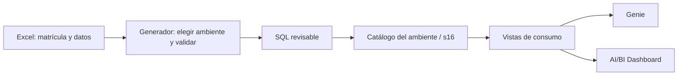
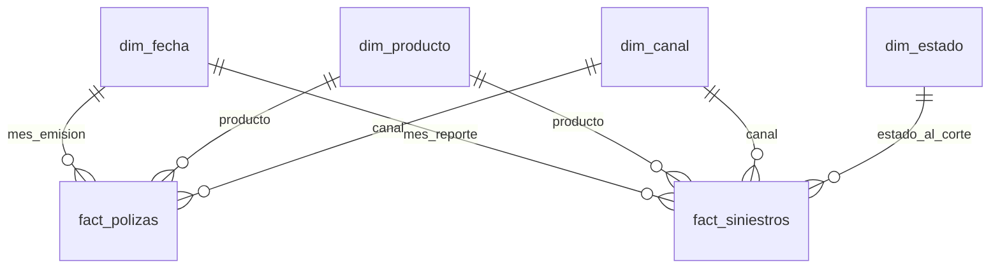

# Laboratorio 16 — De la matrícula Excel a Genie y dashboard

## Metadata

- Módulo: M9, asistentes sobre datos; matrícula de referencia por solicitud del docente.
- Tema: contrato de un Data Product, ambientes y consumo gobernado.
- Tipo: `GUIDED` + `PRACTICE`; actividad formativa sin peso evaluativo adicional.
- Duración: 85 minutos guiados, más 10 de cierre, dentro de la sesión de 120 minutos.
- Nivel: fundamental a intermedio; SQL como vía principal.
- Modalidad: SQL y vistas `PRACTICO_FREE`; Genie, dashboard y PK/FK `PRACTICO_CONDICIONAL`.
- Requiere S3: no. Requiere GitHub: solo para obtener materiales.
- Dataset: un producto de datos, un proceso, cuatro ambientes y datos sintéticos de 2025.
- Conceptos previos: SQL, joins, agregaciones, tablas Delta, vistas y Unity Catalog.

## Contexto de negocio

Operaciones de `aseguradora_demo` necesita consultar siniestros por mes,
producto y canal, y comparar esos resultados con las emisiones de pólizas.
Se registra un Data Product reutilizable para que Genie y el dashboard
utilicen definiciones comunes. Los nombres de roles y los datos son ficticios.

## Objetivo de aprendizaje

Matricular **un único Data Product**, publicar sus tablas en `s16` y comprobar
que las respuestas conversacionales y visuales coinciden con SQL de control.

## Qué aprenderás

- `codigo_dp`: identidad estable del producto, **`DP-SEG-016`**.
- `codigo_proceso`: identidad del proceso de publicación, **`PRC-SEG-016`**.
- `version_contrato`: evolución de definiciones, inicialmente **`1.0.0`**.
- `ambiente`: destino de una implementación; no crea otro Data Product.
- Dimensión: atributos para filtrar y agrupar. Hecho: medidas con grano definido.
- Genie: exploración con preguntas. Dashboard: seguimiento de indicadores acordados.

## Requisitos previos

1. Un catálogo existente y autorizado. El ejemplo usa `workspace`; verificar
   con `SHOW CATALOGS`. El código no crea catálogos ni cuentas.
2. `USE CATALOG` y `CREATE SCHEMA` en ese catálogo para la preparación. Si
   faltan, el instructor prepara `s16` y los objetos.
3. SQL Editor y acceso al SQL Warehouse disponible. Reutilizar el existente.
4. Un `s16` nuevo para este ejercicio. Si ya existe, revisar su contenido antes
   de continuar. `00` falla ante un schema existente para evitar sobrescribirlo.
5. Cada Free Edition independiente ejecuta su propia preparación. Conocer el
   nombre de una tabla de otra cuenta no conecta ambos workspaces.

El owner del Excel es un **rol de negocio documental**. No cambia el propietario
de Unity Catalog ni concede permisos. Estos se administran en la plataforma.

## Dataset

### Hojas del Excel

| Hoja | Uso |
| --- | --- |
| `LEEME` | Instrucciones y límites |
| `matricula` | Una fila con código, owner, dominio, consumidores, freshness, calidad, seguridad, SLO y versión |
| `ambientes` | Cuatro destinos del mismo código; solo DEV habilitado |
| `proceso` | Un proceso: entrada, pasos, salida, ejecución manual y responsable |
| `dim_fecha`, `dim_producto`, `dim_canal`, `dim_estado` | Dimensiones mensuales, de producto, canal y estado |
| `fact_polizas`, `fact_siniestros` | Hechos agregados para el ejercicio |
| `activos`, `relaciones`, `metricas`, `diccionario` | Documentación del contrato y de las relaciones |

Las hojas documentales explican un contrato fijo. Cambiar sus nombres de
objetos o fórmulas no modifica el código: los cambios estructurales requieren
actualizar el generador y sus plantillas. La exportación lee las nueve hojas
de datos: matrícula, ambientes, proceso, cuatro dimensiones y dos hechos.

### Ambientes

| Código único | Ambiente | Destino de referencia | Habilitado |
| --- | --- | --- | --- |
| DP-SEG-016 | DEV | `workspace.s16` | SI |
| DP-SEG-016 | TEST | `seguros_test.s16` | NO |
| DP-SEG-016 | UAT | `seguros_uat.s16` | NO |
| DP-SEG-016 | PRD | `seguros_prd.s16` | NO |

Los catálogos de TEST/UAT/PRD son nombres ilustrativos. La exportación genera
SQL para **un ambiente por ejecución** y bloquea los marcados `NO`.
El schema se mantiene `s16`; el catálogo separa los destinos. Cada tabla recibe
propiedades `training.codigo_dp`, `training.ambiente` y
`training.version_contrato`. No son permisos ni tags gobernados.

En Free Edition se practica DEV; las otras filas documentan el patrón de
promoción. No se presenta un cambio de etiqueta como aislamiento real.

### Grano y controles

| Tabla | Filas | Una fila representa |
| --- | ---: | --- |
| `matricula` | 1 | El Data Product |
| `ambientes` | 4 | Una referencia de ambiente |
| `proceso` | 1 | El proceso que publica el producto |
| `dim_fecha` | 12 | Un mes de 2025 |
| `dim_producto` | 3 | Un producto de seguro: AUTO, SALUD u HOGAR |
| `dim_canal` | 3 | DIRECTO, CORREDOR o DIGITAL |
| `dim_estado` | 2 | ABIERTO o CERRADO al corte |
| `fact_polizas` | 108 | Mes de emisión + producto + canal |
| `fact_siniestros` | 216 | Mes de reporte + producto + canal + estado al corte |
| `vw_indicadores` | 108 | Mes de referencia + producto + canal, con ambos hechos agregados |

Se conservan los totales sintéticos del laboratorio 15: **2328 siniestros**,
**PEN 1546800.00 pagados** y **PEN 946800.00 reservados**. Se añaden canales
ficticios, 23220 emisiones y PEN 9846000.00 de prima emitida. No hace falta
haber ejecutado el laboratorio 15; el Excel es autocontenido.

`SUM(cantidad_siniestros)` cuenta siniestros; `COUNT(*)` cuenta grupos.
Los montos están en PEN y acumulados al **31/12/2025**, agrupados por mes de
reporte. El porcentaje de cierre describe estado al corte. No hay fecha de
cierre ni de cada pago, pólizas individuales, exposición ni prima devengada:
no calcular velocidad de atención, siniestralidad actuarial o causalidad.

La freshness diaria y el SLO son referencias de diseño. La práctica carga un
histórico fijo y no crea programación, Jobs ni garantías de servicio.

## Escenario





Las relaciones son muchos a uno desde cada hecho a su dimensión. No se define
una relación directa entre hechos: los estados de siniestro multiplicarían la
prima si se unieran sin agregar. `vw_indicadores` agrega cada hecho por sus
tres dimensiones compartidas y luego los une. Es una comparación mensual;
no implica que los siniestros correspondan a pólizas emitidas ese mismo mes.

## Actividades

### Opción A — práctica principal

#### 1. Matricular y revisar el proceso — 15 minutos

Abre [matricula-data-product.xlsx](matricula-data-product.xlsx). Revisa la
única fila de `matricula`, completa owner, consumidores y propósito usando
roles ficticios y conserva el código. En `proceso`, explica la entrada y la
salida. En `ambientes`, confirma DEV y su catálogo. Guarda el libro.

El archivo no tiene macros. **Guardar Excel no crea `s16`**: el código lee su
configuración y genera SQL; el schema se crea al ejecutar ese SQL en Databricks.

Si se utiliza el ejemplo sin cambios, los SQL ya están exportados. Si cambia
la matrícula o un dato, el instructor regenera desde la raíz del repositorio:

```bash
python3 -m pip install -r scripts/generate-data/requirements-sesion-16.txt
python3 scripts/generate-data/generar-sesion-16.py \
  --excel sessions/session-16-Genie/resources/laboratorio-16-data-product/matricula-data-product.xlsx \
  --ambiente DEV \
  --salida sessions/session-16-Genie/resources/laboratorio-16-data-product
```

Si descargaste el ZIP, desde la carpeta `laboratorio-16-data-product`
descomprimida utiliza las herramientas incluidas:

```bash
python3 -m pip install -r herramientas/requirements-sesion-16.txt
python3 herramientas/generar-sesion-16.py \
  --excel matricula-data-product.xlsx --ambiente DEV --salida .
```

El script no modifica el Excel, no usa credenciales y no se conecta a Databricks.
Valida matrícula única, destinos distintos, tipos, PK, FK, grano, moneda y
montos. Exporta CSV y siete archivos SQL. El dato de referencia puede cambiar;
en ese caso también deben recalcularse los controles publicados en las guías.

#### 2. Crear `s16` y cargar — demo de 20 minutos

En SQL Editor o como notebooks SQL importados, ejecuta cada archivo por orden:

| Orden | Archivo | Acción |
| --- | --- | --- |
| 00 | [Crear esquema y tablas](sql/00-crear-esquema-y-tablas.sql) | Crea `workspace.s16` y nueve tablas Delta |
| 01 | [Cargar desde Excel](sql/01-cargar-desde-excel.sql) | Inserta los valores exportados con `INSERT OVERWRITE` |
| 02 | [Crear vistas](sql/02-crear-vistas.sql) | Publica `vw_siniestros`, `vw_polizas` y `vw_indicadores` |
| 03 | [Validar y consultar](sql/03-validar-y-consultar.sql) | Contrasta matrícula, cantidades, montos y relaciones |
| 04 | [Dataset dashboard](sql/04-dataset-dashboard.sql) | SELECT para el dashboard |
| 05 | [Relaciones opcionales](sql/05-relaciones-opcionales.sql) | Declara seis PK y siete FK, una sola vez |
| 06 | [Verificar registro en Catalog](sql/06-verificar-catalog.sql) | Lista objetos persistentes, verifica tipo/formato y consulta las filas cargadas |

Ejecuta cada sentencia completa hasta `;` y detente ante un error. `00` se
ejecuta solo al iniciar: si `s16` existe, verifica si es tu práctica ya creada.
Para repetir la carga de tus tablas didácticas, usa solo `01`, seguido de `03`.
`INSERT OVERWRITE` reemplaza esas filas; no cambia otros ambientes.

Las nueve tablas se registran como **tablas Delta administradas en Unity
Catalog**: se utiliza `CREATE TABLE <catalogo>.s16.<tabla> USING DELTA` y se
cargan los datos con `INSERT OVERWRITE` sobre esos mismos nombres. Este patrón
está descrito en la [documentación de tablas administradas](https://docs.databricks.com/aws/en/tables/managed).

Comprueba el resultado en **Catalog → workspace → s16**. Deben aparecer
`matricula`, `ambientes`, `proceso`, las cuatro dimensiones, los dos hechos y
las tres vistas. Abre una tabla y revisa sus columnas y sus datos.
En otro ambiente, selecciona el catálogo configurado en el Excel.

Ejecuta `06-verificar-catalog.sql` después de la carga y las vistas. El listado
debe mostrar los objetos persistentes con `isTemporary = false`; los detalles
de cada dimensión y hecho deben indicar `Type = MANAGED` y `Provider = delta`.
Verifica también 108 filas en `fact_polizas` y 216 en `fact_siniestros` para el
Excel original. La sentencia se documenta en
[SHOW TABLES](https://docs.databricks.com/aws/en/sql/language-manual/sql-ref-syntax-aux-show-tables).
Con los objetos cargados, selecciónalos desde Unity Catalog al configurar Genie
y consulta `workspace.s16.vw_indicadores` desde el dataset del dashboard.

Después de validar los datos, `05` permite observar relaciones en el catálogo.
Las PK/FK de Databricks son informativas y no impiden duplicados o huérfanos;
por eso se valida antes. Si una restricción ya existe, no repitas esa sentencia.
Si la capacidad no está disponible, registra las relaciones en Genie según la
guía. Véase [restricciones en Databricks](https://docs.databricks.com/aws/en/tables/constraints).

#### 3. Configurar el asistente — 25 minutos

Sigue [GENIE.md](GENIE.md): añade fuentes del mismo ambiente, configura las
relaciones, incluye instrucciones y valida dos preguntas. Revisa el SQL
generado antes de aceptar una cifra. Conserva pregunta, SQL, resultado y control.

#### 4. Construir el dashboard — 25 minutos

Sigue [DASHBOARD.md](DASHBOARD.md). Usa un dataset sobre `vw_indicadores`,
añade KPIs, gráficos y filtros; prueba enero/AUTO/DIRECTO. Vincula el Genie
creado si la interfaz lo permite.

### Opción B — fallback para Free Edition

- Sin Python local o lector Excel: ejecuta los SQL exportados incluidos. El
  instructor puede regenerarlos tras editar la matrícula. Los estudiantes
  explican cómo el Excel determina el destino.
- Si se prefiere ingesta visual y el entorno la ofrece: carga una hoja Excel
  por tabla, revisa encabezados y tipos y conserva el mismo contrato. La
  [lectura nativa de Excel](https://docs.databricks.com/aws/en/query/formats/excel)
  depende de la versión disponible. No es requisito del laboratorio.
- Sin PK/FK: conserva el diagrama y configura las siete relaciones en Genie.
- Sin Genie: usa Q4–Q7 de `03`, escribe las instrucciones y completa la ficha
  de asistente como simulación. No se pierde la validación de negocio.
- Sin dashboard: ejecuta `04`, representa los resultados con visualizaciones
  de SQL Editor y entrega el diseño con sus filtros.
- Sin compute por cuota: utiliza los controles de esta guía y las evidencias
  del instructor. Free Edition está sujeto a límites de uso:
  [limitaciones oficiales](https://docs.databricks.com/aws/en/getting-started/free-edition-limitations).

### Qué cambia en producción

Los ambientes tendrían catálogos y, según el diseño, workspaces y permisos
separados. La promoción de código sería controlada con Git y despliegues; la
ingesta usaría fuentes gobernadas y automatización. Cada ambiente tendría su
agente y dashboard conectados a sus propias fuentes. El Excel serviría como
ficha de referencia, con owner, contrato y objetivos sujetos a aprobación del
equipo; no reemplaza Unity Catalog ni un catálogo de productos empresarial.

## Resultado esperado

- Un Excel con un Data Product, un proceso y cuatro referencias de ambiente.
- `workspace.s16` preparado en DEV con cuatro dimensiones, dos hechos, tres
  tablas documentales y tres vistas.
- Dos preguntas contrastadas y un dashboard o sus fallbacks documentados.

## Validación

Los resultados de `03` corresponden al Excel original:

| Control | Esperado |
| --- | ---: |
| Q3: pólizas emitidas | 23220 |
| Q3: prima emitida PEN | 9846000.00 |
| Q3: siniestros / cerrados | 2328 / 1770 |
| Q3: pagado / reservado PEN | 1546800.00 / 946800.00 |
| Q3: porcentaje de cierre | 76.03% |
| Q5: enero / diciembre | 150 / 238 siniestros |
| Q6: enero, AUTO, DIRECTO | 135 emisiones; PEN 81000.00 de prima; 25 siniestros; PEN 20500.00 pagados; 80.00% de cierre |
| Q8: relaciones huérfanas | 0 en las siete relaciones |
| Q9: grano duplicado de la vista | Ninguna fila |
| Q10: diferencias hechos frente a vista | 0 en las cuatro medidas |

## Aplicación en el trabajo diario

La misma ficha permite acordar quién responde por un indicador, qué datos lo
componen y qué ambiente se consume. El modelo con grano explícito ayuda a
investigar cifras duplicadas y a revisar consultas creadas por IA. Una vista
compartida mantiene las mismas definiciones entre el dashboard y el asistente.

## Extensión opcional

En una **copia del libro**, configura un catálogo TEST autorizado y cambia su
habilitación a `SI`. Exporta con `--ambiente TEST --salida /tmp/s16-test` y
comprueba que los CREATE apuntan a `seguros_test.s16` y que el código sigue
siendo `DP-SEG-016`. No es necesario desplegar TEST para completar la sesión.
Las referencias a PRD son exclusivamente formativas.

Fuentes oficiales verificadas el **11 de noviembre de 2026**. La preparación
no requiere AWS, secretos, clústeres clásicos ni APIs externas.
